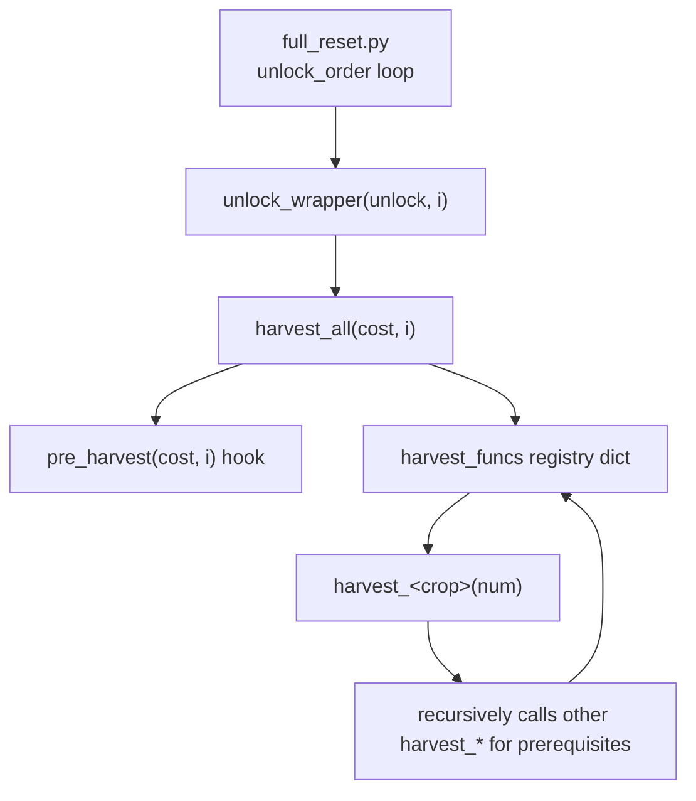

# full_reset — a pluggable crop-harvesting skeleton

A starting point for **The Farmer Was Replaced** built so that the algorithm for
harvesting each crop is a self-contained, swappable module. The driver
([`full_reset.py`](full_reset.py)) walks an unlock plan and, for each unlock,
gathers exactly the items it costs by dispatching to per-crop harvest functions.

[`full_reset.py`](full_reset.py) ships as an empty **skeleton**: a generic driver
plus three CONFIG sections you fill in. [`full_reset_solution.py`](full_reset_solution.py)
is a complete **worked example** built on that exact skeleton, and the per-crop
files are reference implementations you can reuse or replace. To get going, fill
in the CONFIG sections in [`full_reset.py`](full_reset.py) and, for each crop,
copy [`crop_template.py`](crop_template.py).

## Architecture



- `unlock_order` — the strategy script: the sequence of `Unlocks` to buy.
- `unlock_wrapper(unlock, i)` — gets the unlock's cost, harvests it, then `unlock()`s.
- `harvest_all(cost, i)` — runs `pre_harvest`, then gathers each costed item via the registry.
- `harvest_funcs` — registry dict mapping `Items.X -> harvest_x`.
- `harvesting_order` — the order items are gathered within one unlock step.
- `pre_harvest(cost, i)` — optional hook run once per step before the per-item loop.

## Configure your strategy (the 4 plug-in points in full_reset.py)

1. **`unlock_order`** — the ordered `Unlocks` to buy. Reorder/replace freely to
   experiment with different progressions.
2. **`harvest_funcs`** — map each `Items.X` to the function that produces it.
   Point these at the reference crops or your own modules.
3. **`harvesting_order`** — the order items are gathered within a single unlock
   step (only items in that unlock's cost are touched). List **raw inputs last**:
   a crop tops up and then consumes its inputs while farming, so anything also
   owed directly to the unlock (Wood, Hay, ...) must be re-gathered afterward.
4. **`pre_harvest(items_needed, unlock_num)`** — optional per-step hook for
   proactive stockpiling. The skeleton ships a no-op;
   [`full_reset_solution.py`](full_reset_solution.py) uses it to batch
   sunflower/power so power stays above a threshold.

## The harvest-function contract

Every crop module exports one function, `harvest_<crop>(target)`. It must:

1. **Reach the target.** On return, `num_items(Items.<Crop>)` is at least
   `target` (a total amount, not a delta). Loop `while num_items(...) < target`.
2. **Be self-sufficient.** Acquire any items it consumes by calling the relevant
   `harvest_*` functions first, passing the absolute amount needed (the callees
   are target-based too, so no `current`/`delta` math). Read per-plant
   quantities from `get_cost(Entities.<Crop>)` — for example [`carrot.py`](carrot.py)
   uses `get_cost(Entities.Carrot)` to size its `harvest_wood` / `harvest_hay`
   calls, and [`power.py`](power.py) uses `get_cost(Entities.Sunflower)` for carrots.
3. **Leave a clean state.** If it changes global farm state (e.g.
   `set_world_size`), it restores it before returning, as [`cacti.py`](cacti.py)
   does by saving/restoring the original world size.

Because every crop honors the same contract, they compose recursively: asking
for cacti pulls in pumpkins, which pull in carrots, which pull in wood and hay.

Note that `get_cost` only describes a plant's direct cost, so crops with
amplified yields (pumpkin merging, cacti loops) or non-plant inputs (gold/bone
spend weird-substance/cacti as maze fuel) still compute those quantities
themselves.

## Add your own crop in 4 steps

1. **Copy the template.** `cp crop_template.py mycrop.py` and rename
   `harvest_crop` to `harvest_mycrop`, replacing `Items.Crop` / `Entities.Crop`.
2. **Implement the logic.** Fill in `plant_stuff()` (per-tile work) and the four
   marked steps in `harvest_mycrop()`. Use the existing crop files as worked
   examples of the same structure.
3. **Import it** in [`full_reset.py`](full_reset.py):

   ```python
   from mycrop import harvest_mycrop
   ```

4. **Register it** in the same file:

   ```python
   harvest_funcs = {
       ...
       Items.MyCrop: harvest_mycrop,
   }
   harvesting_order = [..., Items.MyCrop]
   ```

That's it — the orchestrator now requests your crop whenever an unlock costs it,
and other crops can depend on it via `harvest_mycrop(n)`.

## Reference implementations

| Module | Item | Notes |
| --- | --- | --- |
| [`wood.py`](wood.py) | `Wood` | Bushes/trees; megafarm + single-drone paths. |
| [`hay.py`](hay.py) | `Hay` | Grass tiles; optional tree polyculture. |
| [`carrot.py`](carrot.py) | `Carrot` | Needs wood + hay. |
| [`power.py`](power.py) | `Power` | Sunflowers; needs carrots. |
| [`pumpkin.py`](pumpkin.py) | `Pumpkin` | Pumpkin merging; needs carrots. |
| [`gold.py`](gold.py) | `Gold` | Maze treasure search; needs weird substance. |
| [`weird_substance.py`](weird_substance.py) | `Weird_Substance` | Tree/grass companions. |
| [`cacti.py`](cacti.py) | `Cactus` | Sort-based harvest; needs pumpkins. |
| [`bone.py`](bone.py) | `Bone` | Dinosaur/snake maze; needs cacti. |

## Running

- **Skeleton:** run [`full_reset.py`](full_reset.py) in-game once you have filled
  in the CONFIG sections. With an empty `unlock_order` it is a safe no-op.
- **Worked example:** run [`full_reset_solution.py`](full_reset_solution.py) to
  execute the full reference strategy.
- **Simulate:** [`simulate.py`](simulate.py) calls the game's `simulate(...)` with a
  filename, seed, and speedup to measure run time without playing live. Edit the
  `filename` (point it at `full_reset_solution` to time the reference run),
  `seed`, and `speedup` variables at the top.
- **Leaderboard:** [`leaderboard.py`](leaderboard.py) calls
  `leaderboard_run(Leaderboards.Fastest_Reset, "full_reset_solution", 1000)` to
  submit a scored run of the worked example. Point it at your own file name to
  submit your strategy instead.

## Notes / known cleanups

These don't affect the skeleton but are worth knowing if you extend it:

- Movement helpers (`move_to_x_pos` / `move_to_y_pos`) and `wait_for_drones` are
  re-implemented in several crop files with slightly different signatures; a
  shared `common.py` would remove the drift.
- [`gold.py`](gold.py) defines `opposite_direction` / `ALL_DIRECTIONS` twice and
  mutates the module-level `ALL_DIRECTIONS` in place inside `search()`.
- The `Megafarm` vs single-drone branch is repeated in most crops and could be
  factored into a shared driver.
